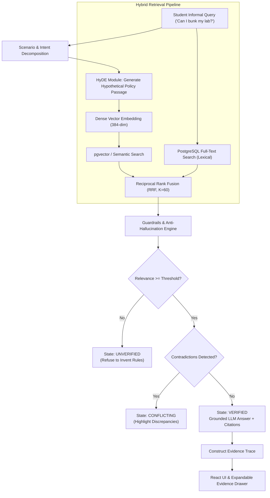

# PolicyPilot: System Architecture & Data Flow

## 1. System Overview
PolicyPilot is an AI-powered campus policy discovery assistant engineered to bridge informal, colloquial student inquiries with formal academic regulatory documents. Official university policies typically employ formal, bureaucratic phrasing (e.g., *"statutory attendance threshold"*, *"exemption authorization"*, *"academic misconduct"*), whereas students naturally express inquiries with slang or situational phrasing (e.g., *"bunk my lab"*, *"WhatsApp cheat"*, *"make it up next week"*).

---

## 2. Component Architecture

### A. Document Ingestion Pipeline
1. **PyMuPDF Extraction**: Extracts textual strings page-by-page while preserving document titles, page numbers, and structural headings.
2. **Recursive Sliding Chunking**: Chunks text with a configured window (`CHUNK_SIZE=600`, `CHUNK_OVERLAP=100`) to maintain contextual continuity across sentences.
3. **Deduplication Engine**: Uses SHA-256 file hashing to prevent redundant re-indexing and wasteful embedding generation.
4. **Vector Storage**: Employs unit-normalized 384-dimensional dense embeddings stored in PostgreSQL / vector storage with cosine distance similarity.

### B. HyDE (Hypothetical Document Embeddings) Pipeline
1. Informal student query is received (e.g., *"Can I skip lab for a gig?"*).
2. HyDE LLM prompt drafts a hypothetical academic passage (e.g., *"Students seeking exemption from scheduled laboratory practicals must obtain prior authorization..."*).
3. The hypothetical passage is converted into a vector and matched against indexed official policies.
4. **Strict Safety Invariant**: The hypothetical text is discarded immediately after retrieval; only real, verified policy chunks from university documents are presented to the LLM or user as evidence.

### C. Hybrid Retrieval & Reciprocal Rank Fusion (RRF)
To avoid over-reliance on purely semantic or purely keyword matching, PolicyPilot runs both retrieval methods in parallel and fuses results via RRF:
$$RRF\_Score(d) = \sum_{m \in M} \frac{1}{K + \text{rank}(d, m)}$$
where $K=60$ acts as a smoothing factor to ensure documents ranking well across both techniques dominate the fused top results.

### D. Guardrails & Anti-Hallucination
Enforces a deterministic tri-state verification system:
- **`VERIFIED`**: Supporting evidence relevance exceeds minimum threshold ($0.20$ for cosine / $0.01$ for fused RRF), and citations point to real pages.
- **`CONFLICTING`**: Inconsistent numerical thresholds (e.g., 75% vs 80% vs 85%) or contradictory deadlines across multiple official policies are detected.
- **`UNVERIFIED`**: Relevance falls below threshold or no policy exists; the assistant explicitly refuses to speculate or invent permissions.

### E. Model Context Protocol (MCP) Server
PolicyPilot exposes a standard MCP server (`mcp_server/server.py`) using FastMCP over STDIO:
- `search_policy(query, top_k)`
- `get_policy_section(document_name, page_number)`
- `list_available_policies()`
- `check_policy_evidence(claim)`
External LLM agents, IDEs (Cursor/Antigravity), and workflows can invoke these tools dynamically.

